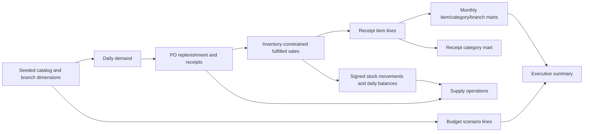
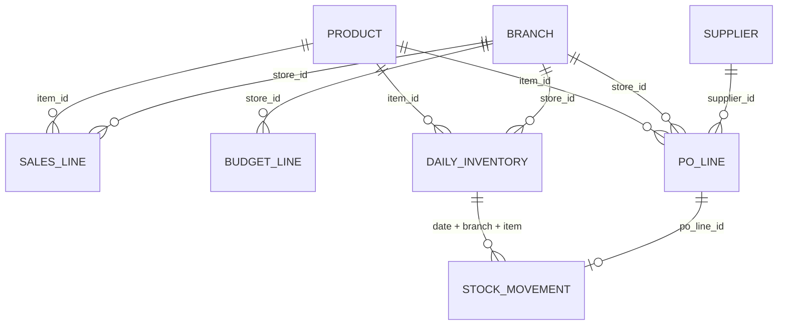

# Retail_Store_Profitability_Analysis

Synthetic home-improvement and household retail case study: 18 branches, 180 SKUs, six operating regions and six categories, January 2025 through October 2026. Both dashboard tabs retain shared month/branch filters. UI is English; amounts are THB million or THB per receipt, excluding VAT and after discounts.

## Run and rebuild

```bash
pip install -r requirements.txt
streamlit run app.py
python src/prepare_data.py
python -m unittest discover -s tests -v
```

Prepared files are included; no uploads, credentials or external datasets are required. `src/thailand.py` generates all active data with seed 20261120. `data/generation_config.json` records the date range, categories, currency and seasonal assumptions. Rebuilding can take several minutes. M5 is no longer an active source. All branches, suppliers, receipts, prices and financial results are fictional, not observed Thailand business statistics.

## Scenario

Regions are internal operating territories, not an official administrative classification. Branches are located in Chiang Mai, Chiang Rai, Lampang, Nakhon Ratchasima, Khon Kaen, Udon Thani, Bangkok, Nonthaburi, Pathum Thani, Chonburi, Rayong, Chachoengsao, Nakhon Pathom, Kanchanaburi, Ratchaburi, Surat Thani, Phuket and Songkhla. Twelve branches open before 2025; six open on quarter starts from April 2025 through July 2026. No sales, inventory exposure or budget coverage predates opening. New = under 365 days old at the selected period end; established = 365+ days. The period-end classification applies to all selected-period revenue.

Categories: Tools, Household, Cleaning, Electrical, Stationery and Lifestyle. Each has 30 SKUs and two departments. Catalog price points range from THB 29 to THB 799. Persistent category/SKU costs and branch cost effects generate different margins. Weekend demand, Songkran, school-season stationery, rainy-season cleaning and year-end demand are scenario multipliers, not measured market effects. New branches ramp up over their first 180 days.

## Pipeline



Opening stock is generated per branch/SKU at opening. PO replenishment uses demand rate and pending supply; goods receipts enter stock before sales, shrink reduces available stock and balances never go negative. Unfulfilled demand is explicitly retained as synthetic unmet demand rather than inventing emergency stock. Received PO quantities plus short-closed quantities equal ordered quantities. Receipts after the dataset cutoff stay open. Sales units are assigned to receipt item lines with a shared price/cost calculation. Summaries are derived from those lines; no independent monthly sales figures are invented. Receipt/category allocated costs reconcile to the branch P&L.

Budgets use catalog price and planned branch demand assumptions with covered opening days. They do not read realized revenue to set revenue targets. Budgets are scenario assumptions, not original real-world business forecasts. Fixed operating-cost scenarios and allocations are documented in the generator.

## Schema and source

| File | Logical primary key | Meaning |
|---|---|---|
| branches.csv | store_id | region_id, province, opened_date, synthetic provenance |
| products.csv | item_id | category, department, price, cost ratio |
| sales_lines.parquet | receipt_id + item_id | date, month, branch, units, price, revenue, COGS; canonical fulfilled sales facts |
| monthly_product.csv | month + store_id + item_id | Aggregated fulfilled item sales, costs, average inventory and active days |
| monthly_category.csv | month + store_id + cat_id | Category financial and exposure totals |
| monthly_store_mock.csv | month + store_id | Revenue, actual distinct receipts, simulated traffic, variable and fixed operating costs |
| receipts/*.parquet | receipt_id + cat_id | Receipt-category values and allocated operating costs |
| receipt_category_month.csv | month + store_id + cat_id | Containing receipt counts and financial totals |
| budget_lines.csv | plan_version + month + store_id + line | budget_amount in THB and observed operating days |
| supply/suppliers.csv | supplier_id | Category supplier and promised lead days |
| supply/purchase_order_lines.csv | po_line_id | Branch/SKU, order/promise/receipt dates and quantity conservation |
| supply/stock_movements.parquet | movement_id | Signed opening, receipt, sales and shrink units; receipt PO FK |
| supply/daily_inventory.parquet | date + store_id + item_id | Opening, receipts, sales, shrink, closing and unmet demand units |



Summaries link by matching month + branch + item/category keys. Never sum branch fixed costs after joining to item or category rows. `currency=THB` is recorded in metadata; budget_amount is currency-neutral. Downloads use base THB units; charts clearly label million/thousand/per-receipt scales.

## Financial and supply definitions

Contribution = revenue - COGS - variable logistics - variable selling - variable labor. Operating profit = contribution - fixed rent - fixed salaries - fixed overhead. Profitable share = positive-operating-profit active branches / active branches. Zero-profit branches remain in the denominator. Currency values are rounded only for display and profit-status classification.

Per-category receipt metrics divide category values by distinct receipts containing that category. A receipt can contain several categories; category receipt counts are not additive. Fixed costs are allocated by revenue share, not treated as transaction-dependent costs.

Supplier reliability uses PO lines promised within the selection, evaluated at the selected final observed day. Future receipts and their quantities are hidden. Zero closing stock is end-of-day exposure, not a real lost-sales estimate. Weekly inventory means use the actual daily balances, including partial weeks.

## Visual checks

Two tabs: Executive summary and Stock control & supplier reliability. No on-screen tables or local decomposition filters. KPI colors convey financial/risk roles with visible labels. Hierarchy height adapts to branch count. Playwright/Chrome captures are written to artifacts/visual-review using `python artifacts/capture_dashboard.py thailand` after installing requirements-dev.txt. Tests independently reconcile raw receipts, stock ledger, PO quantities, budget lines, dates and dashboard filters.

Generated dataset: 966,709 receipts, 2,307,098 receipt-category rows, 333 active branch-month partitions, 1,823,760 daily inventory rows and 157,562 purchase-order lines. The Thailand tests pass (8 checks). Both tabs were reviewed using Playwright at 1366px and 1600px with no runtime exceptions or horizontal page overflow.
