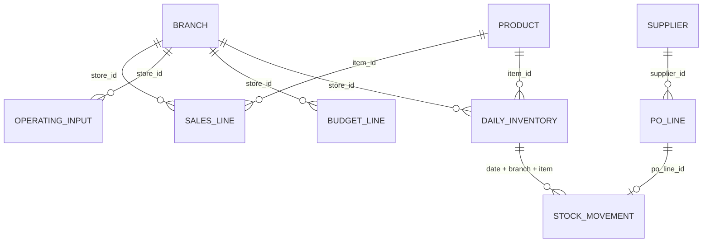

# Retail_Store_Profitability_Analysis

**This project uses mock data augmented by AI.** All branches, receipts, demand, prices, costs, budgets and purchasing records are fictional Thailand retail scenarios. AI assisted the generation rules, code and analytical presentation. These are not real company records or measured Thailand market statistics, and no AI service is called when the dashboard runs.

Portfolio focus: source ingestion, Polars transformations, accounting reconciliation, class-based analytical services and an interactive Streamlit dashboard. Scope: 18 branches, 180 SKUs, six operating regions, January 2025 through October 2026. Values are THB, excluding VAT; aggregate charts use millions and receipt metrics use THB per receipt.

## Run

```bash
pip install -r requirements.txt
python -m src.pipeline
streamlit run app.py
```

`raw_data/` holds the input records. `dashboard_data/` holds published Parquet marts. The app loads a validated published generation and never runs ingestion or generation during normal interactions. If the prepared generation is included, `streamlit run app.py` is sufficient. To regenerate all mock source records and then run the pipeline:

```bash
python -m src.prepare_data
```

Generation can take several minutes; transformation alone is substantially smaller work. To transform existing raw records without regenerating them, run `python -m src.pipeline`. Data generation, ETL and presentation are separate responsibilities.

## Architecture


| Class | Module | Responsibility |
|---|---|---|
| ThailandMockGenerator | src/thailand.py | Seeded NumPy simulation and Polars/Arrow raw-file writing |
| PipelinePaths | src/config.py | Central raw and dashboard paths |
| DataIngestion | src/data_ingestion.py | Lazy CSV/Parquet scans and input fingerprints |
| DataTransformer | src/data_transformation.py | Aggregation, validated joins, receipt allocation and marts |
| DataValidator | src/data_transformation.py | Unique keys, finite nonnegative measures and reconciliations |
| RetailPipeline | src/pipeline.py | Orchestration, validation, versioned output publication |
| DashboardLoader | src/data_loader.py | Read a specific complete published generation |
| DashboardRepository | src/data.py | Cache Polars frames by generation ID |
| RetailAnalytics | src/analytics.py | P&L, budgets, maturity and historical supplier cohorts |
| DashboardView / ChartFactory | src/dashboard.py / src/visuals.py | Render chart-based views directly from Polars |
| KpiCard / DashboardTheme | src/cards.py / src/theme.py | Semantic KPI colors and consistent styling |
| RetailApplication | app.py | Application controller, shared filters and tab layout |

No application or test code imports pandas or converts data to pandas. Polars provides native expressions, lazy scans, streaming collection and Arrow/Parquet storage. Plotly consumes Polars frames directly. Streamlit may install pandas as its own transitive dependency; this project no longer declares or uses it as its processing engine. No fixed speedup is claimed: elapsed time depends on data size, hardware and caching.

## Raw data schemas

| Input | Primary key | Meaning |
|---|---|---|
| branches.csv | store_id | region_id, province, opened_date, provenance |
| products.csv | item_id | cat_id, dept_id, list price and cost-ratio assumptions |
| sales_lines.parquet | receipt_id + item_id | Canonical fulfilled sales: date, month, branch, item, units, unit_price, revenue and COGS |
| branch_operating_inputs.csv | month + store_id | Mock traffic and fixed rent, salaries and overhead; revenue/transactions are recomputed from raw sales |
| budget_lines.csv | plan_version + month + store_id + line | Synthetic target budget_amount in THB and covered operating days |
| supply/suppliers.csv | supplier_id | Mock supplier/category and promised lead time |
| supply/purchase_order_lines.csv | po_line_id | Supplier/branch/item FKs, order/promise/receipt dates, ordered/received/short-closed quantities |
| supply/stock_movements.parquet | movement_id | Signed OPENING, PO_RECEIPT, SALE and SHRINK units; PO FK for goods receipts |
| supply/daily_inventory.parquet | date + store_id + item_id | Opening, receipts, sold, shrink, closing, unmet demand and initial units |
| generation_config.json | configuration | Seed, horizon, THB currency and seasonal assumptions |

The folder formerly named `data` is now `raw_data`. Its previously derived CSV summaries and receipt partitions were replaced with separately published dashboard marts. The raw sales, stock and purchasing facts remain available for independent reconciliation.

## Transform and load

The pipeline lazily scans source sales and inventory, then builds:

- `products.parquet`: month/store/item sales and costs, joined to coverage and inventory balances.
- `category.parquet`: month/store/category financial and stock-exposure aggregation.
- `stores.parquet`: month/store sales, distinct receipts, variable costs and fixed operating inputs.
- `receipt_mart.parquet`: month/store/category containing-receipt counts, revenue, COGS and allocated operating costs.
- `receipt_sample.parquet`: a bounded sample of canonical raw sales lines for download.
- Dimension and operations Parquet files: branches, budgets, suppliers, daily inventory and PO lines, loaded without CSV parsing in the dashboard.

Outputs are written to a unique `dashboard_data/run_<id>/` directory. Only after transformation and validation succeed does an atomic replacement of `current.json` publish that generation. Failed runs leave the previous pointer unchanged. The manifest records row counts, currency, AI/mock provenance and source sizes/modification times. Input changes detected during a run abort publication. The cached loader is pinned to one generation for a consistent set of tables. Older generations can be retained for rollback; deploy `current.json` together with the generation it references.

Stock and financial values are not summed after an uncontrolled many-to-many join. Store operating inputs join at month/store, inventory at month/store/item and receipt allocation at month/store. The pipeline separately verifies source sales totals against the resulting financial marts.



## Mock scenario and formulas

Twelve branches open before 2025; six open on quarterly dates between April 2025 and July 2026. No sales or stock exposure predates opening. New means under 365 days old at the selected period end. Operating regions are internal territories, not an official administrative classification. Categories are Tools, Household, Cleaning, Electrical, Stationery and Lifestyle.

Seeded demand includes branch-size differences, new-branch ramp-up, weekends, Songkran, school-season stationery, rainy-season cleaning and year-end factors. These are explicitly invented scenario effects. Opening balances, PO lead times, receipt delays, short-closing and shrink are simulated. Fulfilled demand is capped by available inventory; unmet demand is retained separately. The simulator writes raw receipt-item facts in branch-sized batches through Arrow, rather than collecting the entire raw history as pandas frames.

- Variable costs = COGS + logistics + selling + variable labor.
- Contribution = revenue - variable costs.
- Operating profit = contribution - rent - salaries - overhead.
- Profitability status uses period profit rounded to cents; zero-profit branches stay in the active denominator.
- Category receipt measures divide by distinct containing receipts. Counts overlap across categories.
- Fixed costs are allocated by revenue share for receipt/category comparison; they are not transaction-dependent expenses.
- Budgets use catalog and planned branch assumptions, not future realized revenue.
- Supplier KPIs use orders promised in the selected period and their receipt status as of period end. Later receipt dates and quantities are hidden in the analytical export.
- Zero closing stock measures end-of-day exposure. It is not observed on-shelf availability or measured lost sales.

## Verification and visual review

```bash
python -m unittest discover -s tests -v
pip install -r requirements-dev.txt
python artifacts/capture_dashboard.py polars
```

Ten checks cover pre-refactor financial totals, raw-sales reconciliation, daily stock continuity and signed-ledger reconciliation, purchase-order receipt identities, budget and profit formulas, no pre-opening exposure, historical as-of visibility, a generated raw-data fixture through the full pipeline, preservation of the previous publication after a failed run, and dashboard tabs/filters. Tests also ensure source files do not import pandas or call to_pandas.

Playwright reviews both tabs and all twelve charts. The two-tab layout, KPI color hierarchy, revenue decomposition and global filters are retained. The dashboard and README explicitly state **mock data augmented by AI**.

Code formatting: `python -m ruff format app.py src tests`. All ten regression checks pass; existing financial totals were preserved through the Polars migration.
